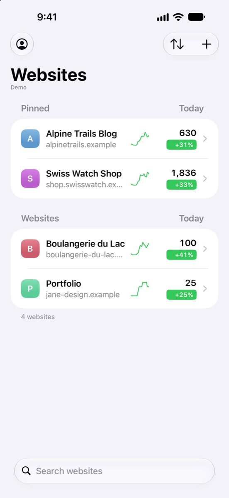
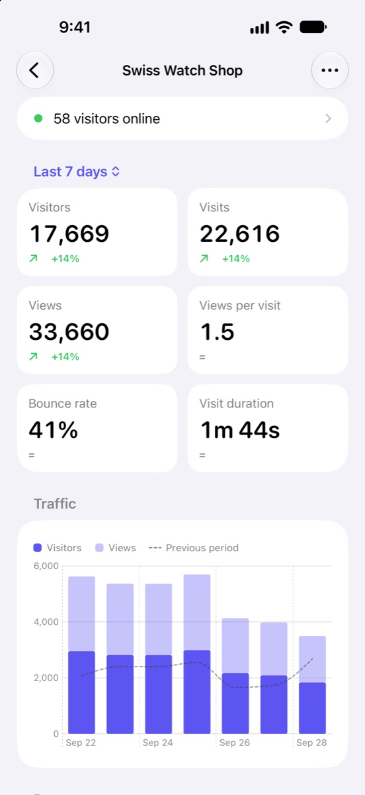
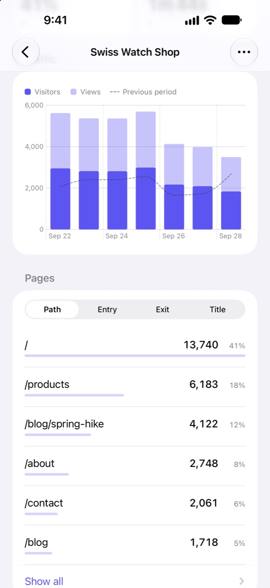
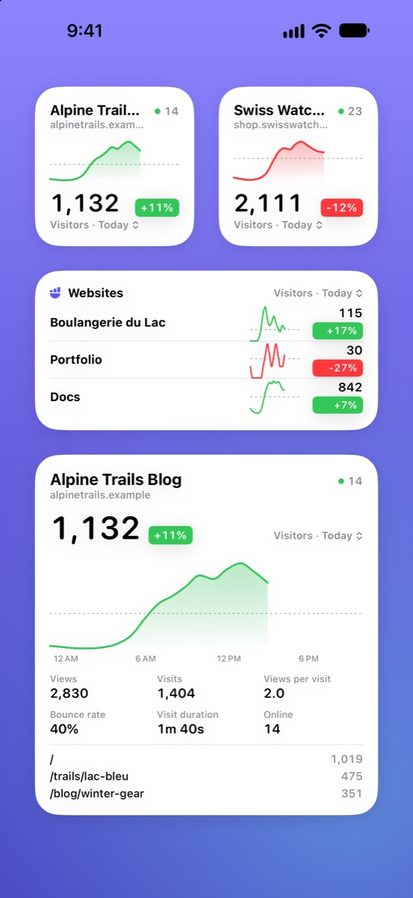

  

<h1 align="center">Pocket Stats for Umami</h1>

  A native iPhone and iPad app for <a href="https://umami.is">Umami</a>, the open-source, privacy-friendly web analytics. 
  Self-hosted servers, Umami Cloud and share links.

  <strong>Made by a web developer, coded with Claude Opus 5.5.</strong>

  <a href="https://apps.apple.com/app/id6816833400">App Store</a> ·
  <a href="#build-it-yourself">Build it yourself</a> ·
  <a href="docs/DEVELOPMENT.md">Development guide</a> ·
  <a href="changelog.md">Changelog</a>

  
  
  
  

---

## Built with AI, and proud of it

I'm a web developer, not an iOS developer. I had never shipped a native app before this one.

Pocket Stats for Umami was coded with **[Claude Opus 5.5](https://www.anthropic.com/claude)**, Anthropic's AI model, through Claude Code. I decided what the app should do and how it should look, tested it on my own iPhone and iPad, and reported what was wrong. Claude wrote the Swift code.

I'm not hiding it, because it's the point: an idea no longer has to wait for someone to learn a whole new platform. The whole source is here, so you can judge the result for yourself.

## Features

- **Dashboard** for every website: visitors, visits, views, bounce rate and visit duration, compared with the previous period, and a traffic chart.
- **Breakdowns**: pages, entries and exits, referrers, countries, cities, languages, browsers, OS, devices and events.
- **Realtime** visitors.
- **Websites list** with sparklines, change badges, pinned websites and a period of your choice.
- **Website management**: create, edit, delete, reset, tracking code.
- **Widgets** for the Home Screen and Lock Screen, a **Control Center** control, **Siri and Shortcuts**.
- **Several accounts** side by side: self-hosted (username and password), Umami Cloud (API key) or a read-only share link.
- **Demo mode** to try everything without a server.
- English, French and German. iOS and iPadOS 26 or later.

## Privacy

The app talks only to the Umami server you enter (or to the Umami Cloud API). No analytics, no ads, no third-party SDKs, and nothing is collected. Passwords, tokens and API keys stay in the device Keychain.

## Get the app

The easiest way is the [App Store](https://apps.apple.com/app/id6816833400). It is a one-time purchase, with no subscription or in-app purchases. Buying it pays for the Apple Developer membership and supports the work on the app. Thank you!

## Build it yourself

The source is public so that anyone can read it, check what it does with their data, and install it on their own devices.

**Requirements**
- A Mac with **Xcode 27** or later.
- An Apple account. A free one is enough to install the app on your own device, but Apple makes apps signed this way expire after 7 days; a paid Apple Developer Program membership removes that limit.

**Steps**
1. Clone the repository and open `AnalyticsForUmami.xcodeproj`.
2. Copy `Config/Local.xcconfig.example` to `Config/Local.xcconfig` and set:
   - `DEVELOPMENT_TEAM` to your Team ID (Xcode › Settings › Accounts);
   - `APP_BUNDLE_ID` to an identifier of your own, such as `com.yourname.pocketstats`.

   The widget and the App Group derive their identifiers from it. `Local.xcconfig` is ignored by git.
3. Select the `AnalyticsForUmami` scheme and your device, then press ⌘R. Xcode registers the identifiers and the App Group on the first build.

To try it in the Simulator, no signing setup is needed: pick a simulator and press ⌘R.

## License

The source code is available under the **[PolyForm Shield License 1.0.0](LICENSE.md)**. In short, and without replacing the license text:

- ✅ You can read, build, modify and use the app for yourself, your company or your clients, and share your changes.
- ❌ You cannot publish the app, or an app based on it, that competes with Pocket Stats for Umami: not on the App Store, not elsewhere, and not for free either.

This is a *source-available* license, not an OSI-approved open-source license.

The name "Pocket Stats", the app icon and the App Store screenshots and artwork are not covered by the license: see [TRADEMARKS.md](TRADEMARKS.md).

## Contributing

Bug reports, ideas and pull requests are welcome: see [CONTRIBUTING.md](CONTRIBUTING.md). The [development guide](docs/DEVELOPMENT.md) describes the architecture and the quirks of the Umami API.

## Not affiliated with Umami

Pocket Stats for Umami is an independent app, not affiliated with or endorsed by Umami Software, Inc. "Umami" is used only to describe compatibility. [Umami](https://github.com/umami-software/umami) itself is open source under the MIT License.
